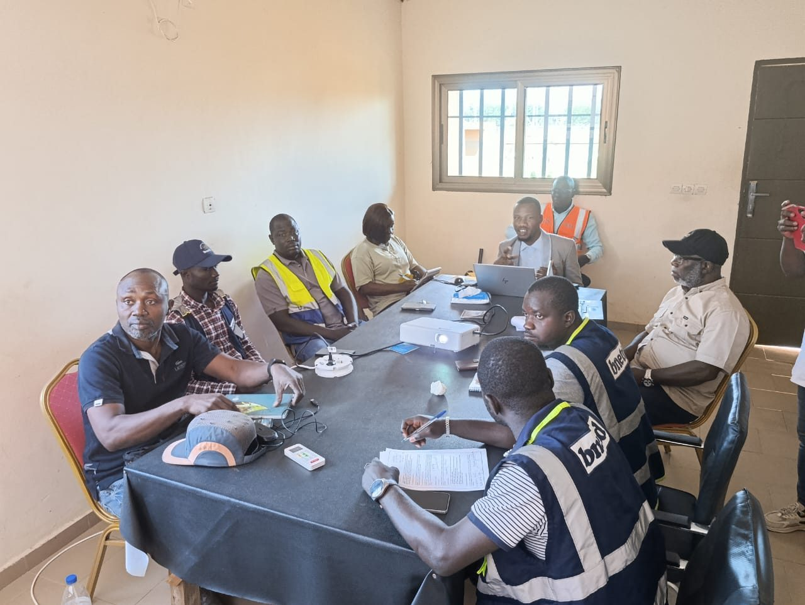
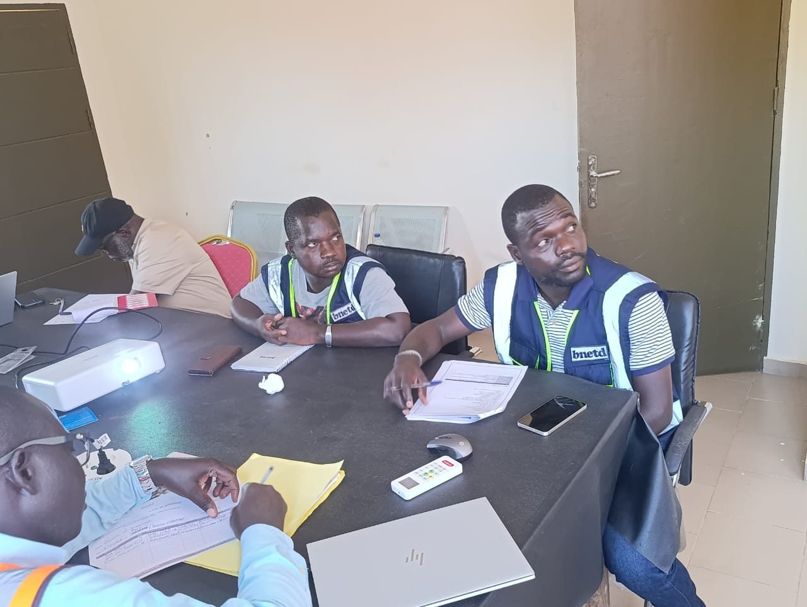
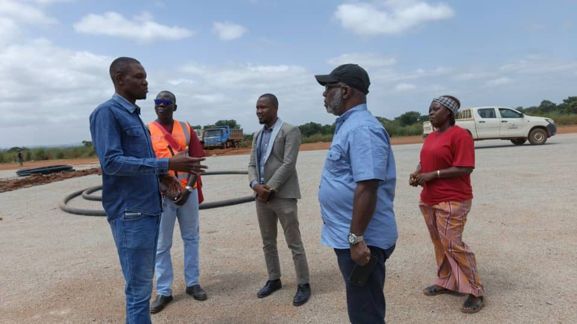
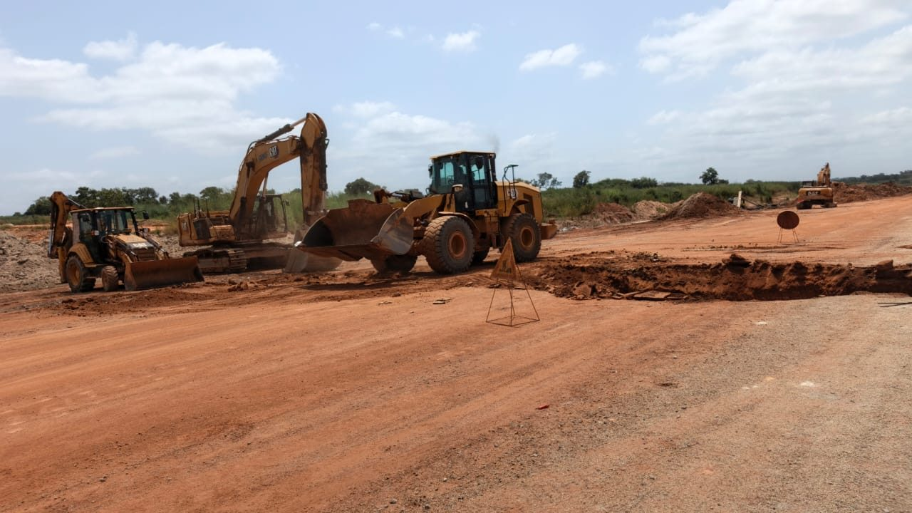

**Retenue par EBOMAF, l'ONG Sécurité Vie a lancé à Kong une campagne de sensibilisation sur les IST et le VIH/sida, les violences basées sur le genre et la sécurité routière. Dès la réunion de démarrage, tous les acteurs du projet ont validé la stratégie, le calendrier et les messages.**

*Kong, 26 octobre 2026.* À Kong, les engins tournent déjà sur le futur aéroport. Ce chantier d'envergure ouvre de réelles perspectives pour la région. Il fait aussi courir des risques aux travailleurs et aux riverains : la circulation des camions et des engins, les IST et le VIH/sida, les violences basées sur le genre. Pour les prévenir, l'entreprise EBOMAF a confié à l'ONG Sécurité Vie une mission de sensibilisation qui accompagne les travaux.

### Tous les acteurs autour de la table

La mission a démarré par une réunion dans les bureaux d'EBOMAF à Kong. Autour de la table se trouvaient l'entreprise, la mission de contrôle (BNETD) et les maîtres d'œuvre délégués (SODEXAM et Terrabo). La campagne a été présentée par M. KEAN Dion Anselme, Directeur exécutif de l'ONG Sécurité Vie. Les participants ont ensuite examiné les supports un à un. Ils ont validé ensemble la stratégie, le calendrier signé des activités, les slogans et les messages des panneaux qui jalonneront les abords du chantier. Un groupe d'échange permanent réunit désormais toutes les parties prenantes, afin que chaque décision soit suivie jusqu'au terrain.

<figure><figcaption>EBOMAF, le BNETD, la SODEXAM, Terrabo et l'ONG Sécurité Vie valident le calendrier et les messages.</figcaption></figure>
<figure><figcaption>La mission de contrôle associée dès le lancement.</figcaption></figure>

### Sur le terrain, aux côtés des équipes du chantier

L'équipe de l'ONG a ensuite parcouru le site, accueillie par le coordonnateur terrain. Cette visite lui a permis d'observer les zones de travaux, les mouvements d'engins et les points de contact avec la population. Les messages de la campagne partent de ces réalités.

<figure><figcaption>L'équipe de l'ONG accueillie sur le site par le coordonnateur terrain.</figcaption></figure>
<figure><figcaption>Le chantier de l'aéroport de Kong, où la campagne prend tout son sens.</figcaption></figure>

### La prévention comme facteur de cohésion

La campagne fait de la prévention un levier de cohésion et de fraternité. Elle culminera avec une journée sportive inter-services, du 10 au 12 novembre. Les travailleurs du chantier, les corps habillés, les chauffeurs, la jeunesse et les groupements de femmes s'y retrouveront. La journée se prolongera par la vaccination du personnel et un dépistage volontaire du VIH.

### Mesurer pour prouver

Une enquête sur les connaissances, attitudes et pratiques (CAP) ouvre la campagne, et une enquête finale, du 22 au 24 novembre, la referme. Ainsi, les résultats ne seront pas seulement annoncés : ils seront mesurés. Depuis le 27 octobre, nos équipes rencontrent les leaders communautaires de Kong. Une réunion technique avec la préfecture et les services techniques est prévue le 5 novembre.

> « Ta famille t'attend à la maison, reste prudent au volant. »  
> « Au volant, tu tiens des vies entre tes mains. »  
> « Le VIH est réel, protège-toi et protège les autres. »  
> *Slogans validés par les parties prenantes*

*Partenaires : Ministère des Infrastructures et de l'Entretien Routier, SODEXAM, Terrabo, BNETD, EBOMAF.*
